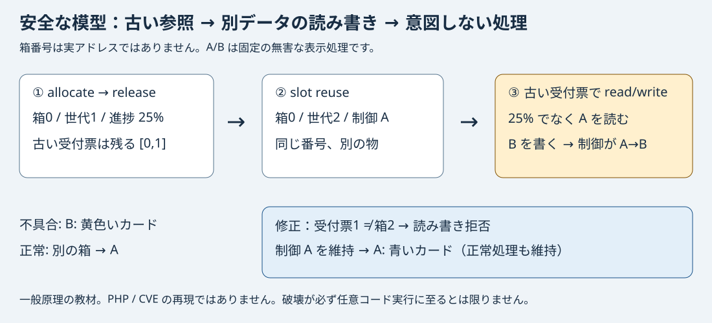

# 古い受付票と入れ替わる箱 — memory-slot-lab

ネットワーク不要の安全な意味論シミュレーションです。実際の C メモリ破壊や
php2shell / CVE-2026-109618、109619 の再現ではありません。2026-10-21の公式公開内容との
対応・相違を下に整理しました。実CPUアドレス、シェル、任意コード評価は扱いません。

## 最短で試す（Node.js 22 以降、外部依存なし）

この問題ディレクトリから:

```sh
node local/app/demo.mjs
node --test tests/*.test.mjs
node local/app/server.mjs
```

最後のコマンドで `http://127.0.0.1:8080` を開きます。停止は Ctrl+C。
ブラウザの予想欄を埋めて比較を実行し、スライダーで状態を追います。
下の JSON プログラムを編集して再実行してください。ページは外部 JS や画像を読み込みません。
PHP公式マニュアルへのリンクは任意で、実験に不要です。

採点契約を単独で試す場合は別のターミナルで:

```sh
FLAG_SEED=local-fixture-only node local/verify/server.mjs
curl -s http://127.0.0.1:8081/verify -H 'Content-Type: application/json' \
  -d '{"submission":"{\"guards\":[[\"slot.live\",\"==\",true],[\"handle.generation\",\"==\",\"slot.generation\"],[\"slot.owner\",\"==\",\"caller.owner\"],[\"slot.kind\",\"==\",\"caller.kind\"]]}"}'
```

実行ごとの fixture seed は外部サービスの秘密ではありません。プラットフォームでは
`secretEnv` から注入されます。公開面には渡さず、採点面の検査ケースの値だけに使います。
コード課題の解答は seed の当て物ではありません。正誤は提出プログラムの動作で決めます。

## 問題と参加者の経路

保守担当として「遅れた更新のあとに色が変わる」という症状を調べます。
最初は予想→公開例の実行→箱と受付票の追跡。その後、比較式の JSON プログラムを作り、
通常の読み書きを保ちながら不適切な読み書きを拒否します。型や所有者も画面で定義しています。
単に修正スイッチを押す演習ではなく、比較の対象や演算子を変えるとどの状態で破れるかを実験します。
公開例以外のテストも採点対象と問題文に記載しています。

## 図と期待する挙動（設計上の予想）



|同じ入力 B|進捗の受付票で読む|進捗の受付票で書く|現在の制御値→処理|
|---|---|---|---|
|正常（進捗箱を保持）|25%|進捗箱だけ B|A → 青いカード|
|不具合（解放→箱を再利用）|別の制御データ A|制御データを B に変更|B → 黄色いカード|
|修正（同じ解放→再利用）|古い世代として拒否|古い世代として拒否|A → 青いカード|

正常列は寿命が異なる対照実験です。不具合列と修正列は同じ確保・解放・再利用・入力を使い、
参照の検査だけを変えます。修正列は最初は未修正。参加者の検査プログラムで動きます。

## コードと解答（運営・解説用）

- `local/app/model.mjs`: `allocate` は空き箱を選び世代を増加。
  `release` は使用中の印を消すだけで、古い受付票のコピーは残ります。
- `resolve`: 箱番号だけを信用すると、同じ番号の別オブジェクトも返します。
  受付票の世代と現在の世代、呼び出し元の所有者・期待種類、使用中の印を検査します。
- `read` / `write`: 両方が `resolve` を通ります。読み取りを拒否しただけで
  書き込みの穴が隠れないよう、実験では独立に両方を試します。
- `scenario`: ステップごとの状態をコピーして記録します。過去ログが後の書き込みで変わりません。
- `dispatch`: A/B の固定表相当。値 B は実行可能コードではありません。
- `local/verify/grade.mjs`: 公開面とは別プロセス・別イメージ。クライアントの成功ログを信用せず、
  正常、解放、複数回再利用、同じ所有者と種類での再利用、所有者違い、種類違いを実行します。

参照解答:

```json
{"guards":[["slot.live","==",true],["handle.generation","==","slot.generation"],["slot.owner","==","caller.owner"],["slot.kind","==","caller.kind"]]}
```

比較式は `[左辺, "==" または "!=", 右辺]` の形です。左右は公開されたフィールド名か真偽値です。比較順序は任意です。
同じ値同士の自己比較、逆の演算子、拒否し過ぎでは合格しません。意味が等しい左右の入替えや余分な真の式は認めます。`slot.live == true` だけでは、再利用されて「使用中」に戻った箱を防げません。
所有者と種類の比較だけでは、同じ所有者・同じ種類で再利用された箱を防げません。
世代だけでは、同世代の別所有者・別種類の呼び出しや解放直後を防ぎません。
この比較式の仕組みでは4つの性質の検査が必要です。所有権や寿命を設計で保証する別の実装もあり得ます。

## 制御情報、戻り先、PHP の話題との関係

誤書き込みが「どの処理を呼ぶか」という制御情報に届くと、意図しない処理へつながり得ます。
戻り先アドレスの上書きは、関数から戻る先を変える例。本模型は、解放したヒープの物が
再利用され、その中の関数ポインタのような情報を古い参照で変える例に近く、スタックの戻り先を
上書きしていません。A/B はラベルで、実CPUのアドレスではありません。
実際の破壊はクラッシュだけで終わる場合や、保護・型・所有権検査で止まる場合もあります。
破壊が必ず RCE（任意コード実行）に進むと考えてはいけません。

[PHP公式マニュアル](https://www.php.net/manual/en/session.upload-progress.php) は、
アップロード進捗情報がスクリプト実行前にセッションへ書かれると説明しています。
「multipart 入力の受信→進捗の記録→アプリの実行」という前処理の存在を考えるきっかけですが、
マニュアルだけから CVE の原因は判断できません。公式公開後の確認結果は次のとおりです。
この教材の release/reuse の順序は一般原理を見せるための架空の設計です。

## 2026-10-21 の PHP 公式情報との対応・相違

[PHP公式告知](https://www.php.net/index.php)で、修正版は **8.2.35 / 8.3.36 / 8.4.27 / 8.5.12**
と確認しました。以下は公式説明の要約と模型の位置付けであり、実CVEの検証結果ではありません。

|公式に説明された問題|この模型との関係|
|---|---|
|[CVE-2026-109618 / GHSA-w8hw-w9fx-j79w](https://github.com/php/php-src/security/advisories/GHSA-w8hw-w9fx-j79w): メモリ不足（OOM）時の `longjmp()` による途中退出で、初期化途中の不正な状態を終了処理が読んだり分岐に使ったりし得る。|模型にはOOM、`longjmp()`、初期化途中の状態、PHPの終了処理がない。この原因は再現していない。|
|[CVE-2026-109619 / GHSA-6wmf-4rv5-p3rp](https://github.com/php/php-src/security/advisories/GHSA-6wmf-4rv5-p3rp): 前のリクエストが所有したメモリの解放後も、ワーカーのグローバル状態に参照が残り、同じワーカーの次のリクエストが通常初期化前に使い得る。|「解放した物への古い参照が残り、後で別の物に届く」という寿命の問題は近い。ただし模型は単一の配列上の操作列で、HTTPリクエスト境界・ワーカー・PHP内部のグローバル状態を実装していない。|

後者の公式説明は、セッションのアップロード進捗処理も通常初期化前に状態を使い得る経路として挙げています。
この教材の「進み具合」という題材は説明用の比喩です。multipart入力やPHPセッションの実装ではありません。
PHP側の対策はそれぞれOOM時の退出方法の変更と状態のリセットです。模型の世代・所有者・種類の検査は
学習用の設計であり、PHPの修正パッチや実環境の対策を代替しません。

公式は実際のRCEを報告していますが、本教材で観察できるのは固定のA/B表示の切替えだけです。
実アロケータ、ヒープ配置、実行アドレス、攻撃ペイロードは扱いません。実CVEの再現・exploit・パッチ検証を
行ったとは主張しません。模型での成功は実システムの安全性を証明しません。

## コンテナと既存 TenkaCloud 契約

```sh
FLAG_SEED=local-fixture-only docker compose -p memory-slot-lab -f local/docker-compose.yml up --build -d --wait
# Web: http://127.0.0.1:18080
# verify: http://127.0.0.1:18081/verify
FLAG_SEED=local-fixture-only docker compose -p memory-slot-lab -f local/docker-compose.yml down
```

公開ポートは loopback 限定、非 root、read-only filesystem、healthcheck 付き。
公開面のイメージには採点コード、fixture seed、参照解答、テストをコピーしません。
サーバーは `/` と `/model.mjs` と healthcheck だけを配信します。
採点は既存 `verify` の `{submission: string}` → `{correct: boolean}`。
正解100点、誤答5点、ヒント20/30点。Portal が点を管理します。

カタログの正本はこのリポジトリです。本体の生成 `problems/` は編集しません。
TenkaCloud の独立した確認用 checkout で、local path を指定する取得元設定を使って
`make catalog-download CATALOG_SOURCES=<設定ファイル>` → `make catalog-prepare`、その後
`CATALOG_SOURCES=<設定ファイル> make local` で新しいイベントにこの問題を選びます。
参加者は起動後の Web を開き、プログラム JSON を提出欄へ貼り付けます。
この Portal のイベント作成→起動→採点→撤収の一巡は今回未検証です。
Docker のローカル実行は既存 host の対応 Linux 隔離要件にも従います。Cloud 開催では Docker 問題は対象外です。

## 実測と未確認

- `observed-demo.json`: `node local/app/demo.mjs` の実出力。A/B/B等を手書きした期待値ではありません。
- 2026-10-21: Node 26.5.0 で `node --test tests/*.test.mjs` 5/5成功。
  全16通りの検査集合（不完全15種は拒否）、比較順序/左右の入替え、自己比較・逆演算・全拒否の失敗、2 seed、HTTP契約、非公開パス拒否を確認。
- `make agent-gate`: 25件のmetadata検証と11件のrootテスト成功。
- TenkaCloud本体の `loadContainerProblem` と `checkComposePolicy` で、この問題のmanifest読込成功・違反0件。
- Chrome の実画面で修正プログラムを入力し、正常A・不具合B・修正Aの表示を確認。
- Node 22 Alpine の2イメージはビルド成功。`--network none` の採点イメージ内でも
  HTTPを含む専用テスト5/5成功（read-only・非root・ネットワークなし）。
- Compose は既存 Docker の `all predefined address pools have been fully subnetted` で
  ネットワーク作成に失敗。サービスは起動していません。他のネットワークを消す対応はしません。
- 実Cの破壊、実PHP、CVE、任意コード実行、本番、AWSは検証対象外です。

## コストと撤収

AWS 等の有料リソースは作りません。Region は該当なし。目安30分、ローカルCPU/メモリだけを使います。
Node サーバーは Ctrl+C、コンテナは上記の同じ project 名で `down`。永続ボリュームはありません。
カタログには問題文・運営向け解答が同居するので、競技の非公開解答の代わりにはなりません。
